# @rafaelachagas — os 4 padrões de gancho de vídeo viral, cada um demonstrado na própria edição

## O que ensina

Reel educativo de 1:18 (77,8 s) sobre retenção: "você tem três segundos" para prender a atenção, e
quatro padrões se repetem em vídeo viral — (1) **gancho visual** (texto colorido, elementos, efeitos
sonoros, imagem atrás) antes de falar, (2) **movimento logo na primeira cena**, (3) **dinamismo**: um
ângulo de câmera diferente a cada frase, (4) **títulos** que dizem do que se trata antes da primeira
palavra. Fecha dizendo que o fim importa tanto quanto o gancho, com CTA de comentário. A força do post
é que **cada padrão é demonstrado no mesmo instante em que é dito** (a TV atrás muda quando ela fala de
"imagem atrás", a câmera treme quando fala de movimento, o ângulo troca quando fala de dinamismo, o
título ocupa a tela quando fala de títulos).

Legenda do post: "Eu não imaginava que isso ia funcionar 👀". Números lidos em 13/10/2026: **46,6 mil
curtidas** e **1.852 comentários** (batem com `like_count`/`comment_count` do yt-dlp); um terceiro
contador, **463**, aparece junto aos botões Repostar/Compartilhar — qual dos dois ele conta: não
verificável pelo DOM. Visualizações: não verificável (não apareceram). Data de publicação: 08/09/2026
(timestamp do yt-dlp).

## Mapa do vídeo

Vídeo inteiro visto em folhas de contato a 2 qps (13/13 folhas), com zoom em 18 quadros.

| Tempo | Cenário / plano | Fala | O que a tela faz | Print |
|---|---|---|---|---|
| 0:00–0:03 | bastidor **vertical cheio**: estúdio com 2 câmeras em tripé, refletor, operador; ela diante da TV que mostra uma janela de trem | — (sem fala transcrita) | texto nativo do Reels em 2 linhas, branco, centro: "nem a p4u que isso vai funcionar ☠️" | 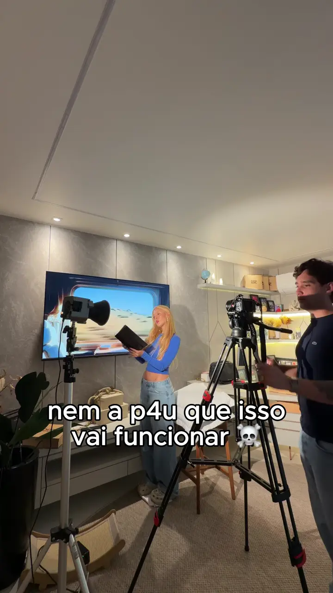 |
| 0:03–0:09 | vira **16:9 com faixas pretas**; "janela de trem" com paisagem correndo, plano médio, ela com um livro | "Você tem três segundos para aprender a atenção das pessoas e tudo começa com um gancho" | uma palavra por vez, **azul**, dentro da área da janela, ao lado da cabeça | 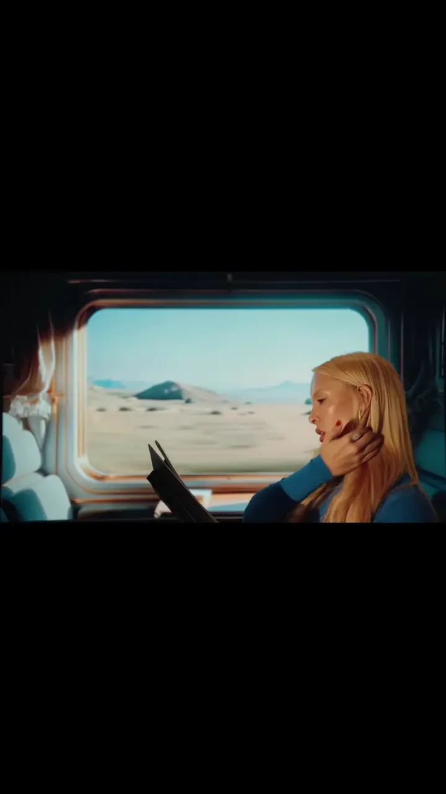 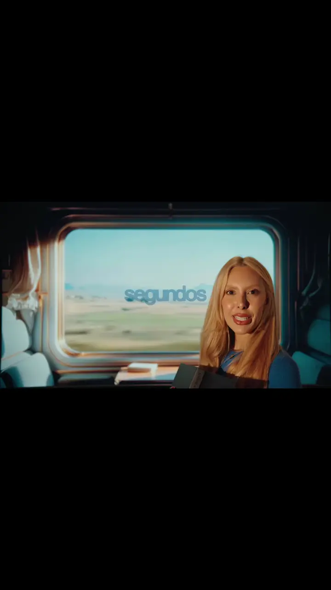 |
| 0:09–0:12 | close grande-angular colado na lente, ela abana a mão na frente da câmera; TV ao fundo | "E existem quatro padrões que se repetem em todo o vídeo viral" | palavra única creme, canto inferior direito; numeral "4" | 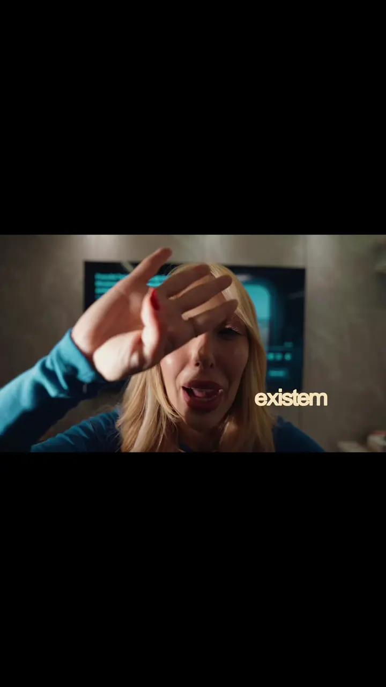 |
| 0:12–0:24 | plano médio diante da TV; a imagem da TV troca (mar → lava → penhasco/mar → ilha) | "O primeiro são esses ganchos visuais… texto colorido, elementos, efeitos sonoros, uma imagem atrás" | colagem de cartões de Reels de exemplo (13,5–18 s); exemplo "Vlog Europa / Sephora" (19–22 s); ela aponta a TV em "atrás" (24 s); palavra única creme no alto, uma em rosa ("que", 15 s) | 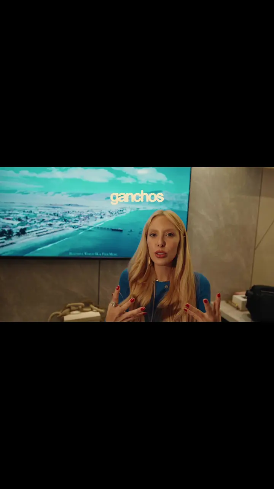 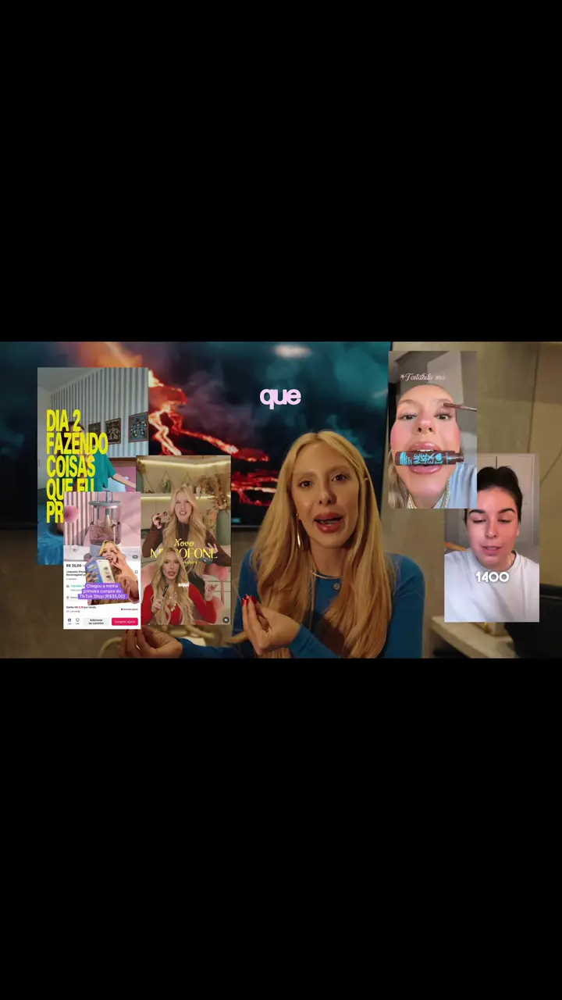 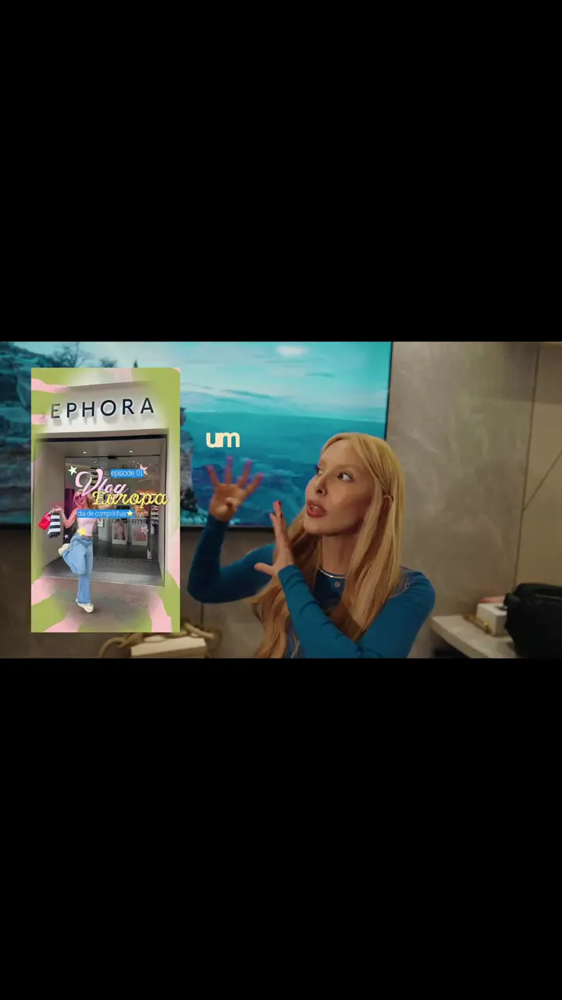 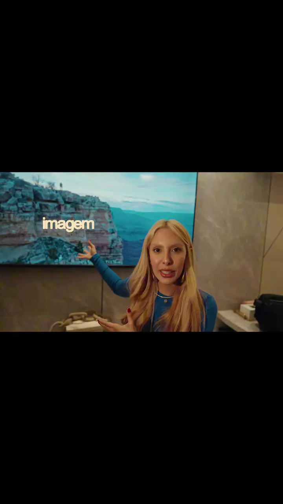 |
| 0:24–0:34 | sala com sofá e cozinha ao fundo; **câmera na mão**, grande-angular, ela mexe na lente, sai do quadro e anda | "O segundo é o movimento logo na primeira cena… tremendo o celular, passando uma maquiagem, mexendo na câmera" | cartão de exemplo à esquerda (moça de regata 25–28 s; vídeo "tremendo" 30–31 s; maquiagem 31,5–32 s); palavra única creme no meio | 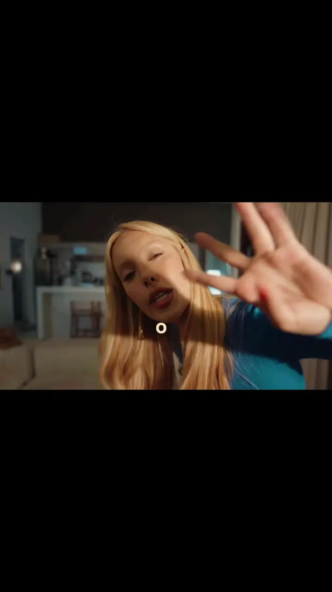 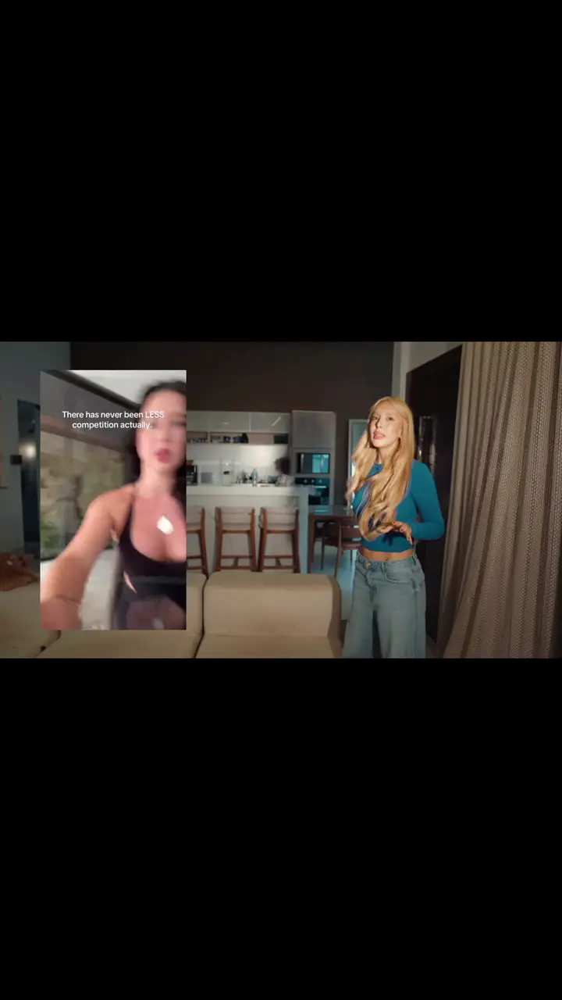 |
| 0:34–0:38 | plano aberto **fixo**, ela sentada no braço do sofá, cozinha ao fundo | "O nosso olhar presta atenção no movimento e não em algo estático parado" | palavras **grandes** creme no alto, acima da cabeça ("nosso", "no", "em", "estático") |  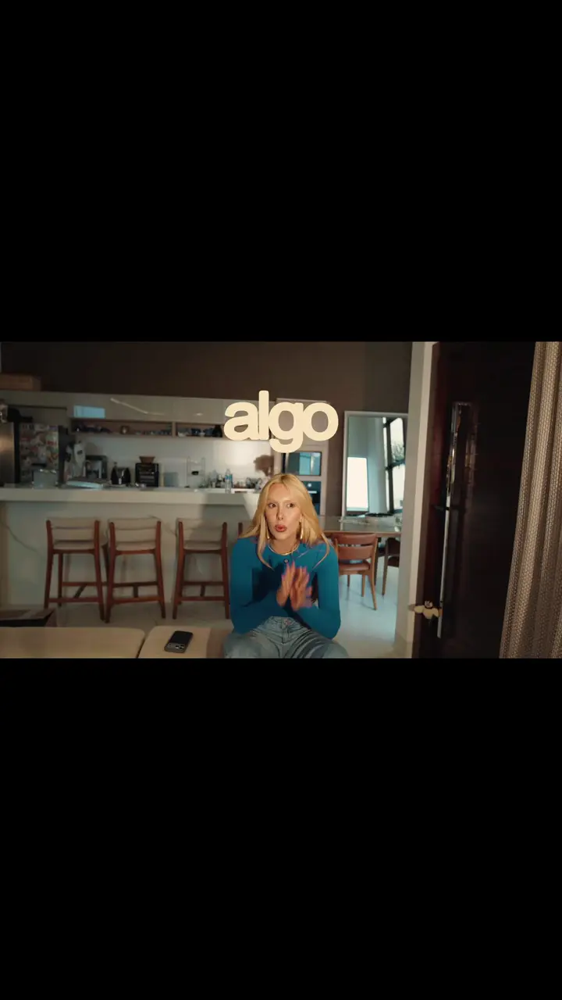 |
| 0:38–0:50 | cozinha com janelão e mesa; ângulo troca a cada frase: aberto (38–40 s) → close na lente (40,5–42 s) → aberto (42,5–44 s) → médio (44,5–50 s) | "O terceiro é o dinamismo. Para cada frase que você falar, você grava em um ângulo diferente… efeito dopaminérgico… até o final" | palavra única no meio, alternando **rosa** ("terceiro", "dinamismo", "dopaminérgico", "fiquem") e creme | 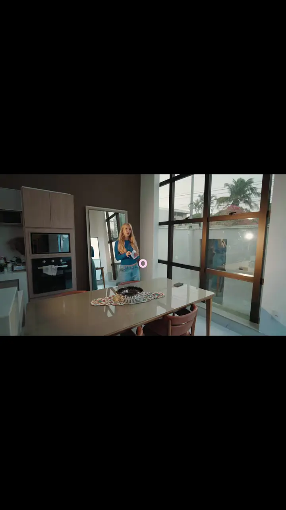 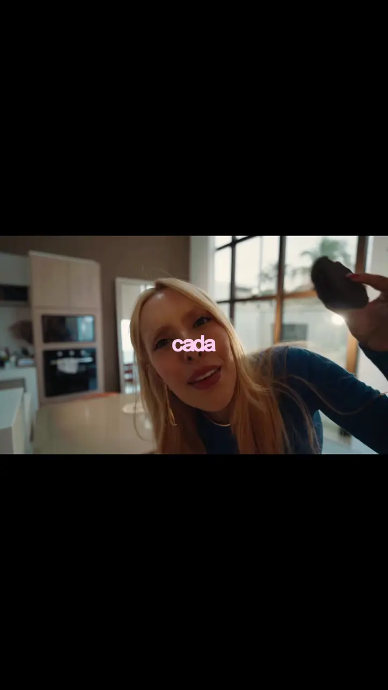 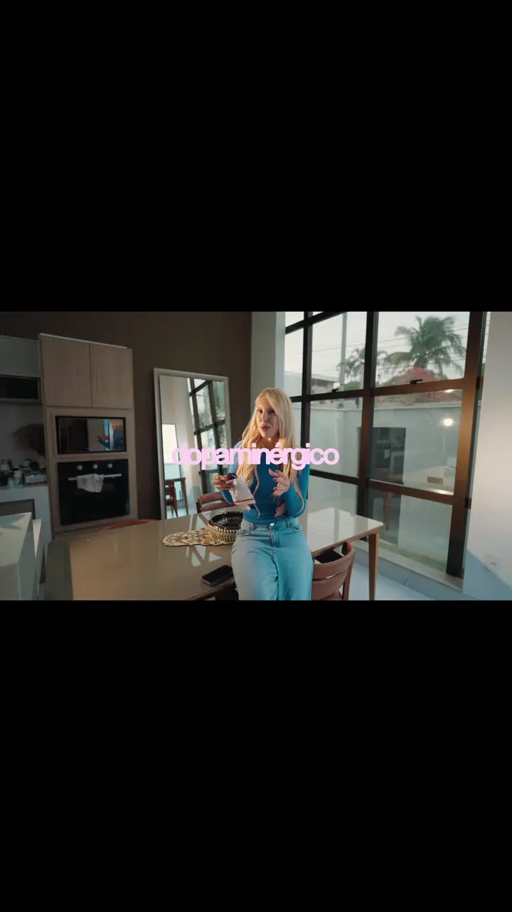 |
| 0:50–0:55 | sofá, plano médio frontal, fundo desfocado | "E o quarto são os títulos. Você já mostra do que se trata o seu conteúdo antes mesmo de dizer uma palavra" | palavra única pequena à esquerda do rosto (creme; "palavra" em rosa) | 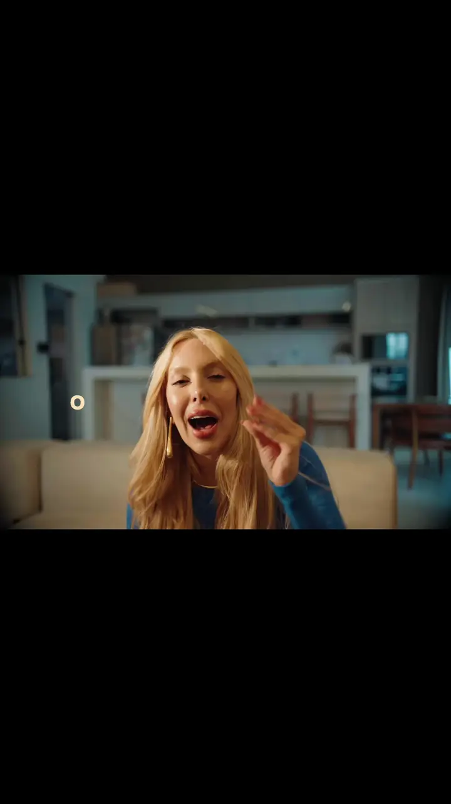 |
| 0:55–1:01 | mesmo plano | "Esses títulos que ocupam a tela inteira, coloridos, com elementos, efeitos sonoros são maravilhosos" | palavras **gigantes** creme na base do quadro ("esses", "títulos", "ocupam", "tela", "inteira") — 55,5–57 s; depois cartões de exemplo com títulos coloridos dos dois lados | 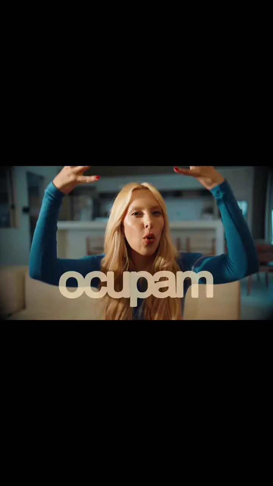 |
| 1:01–1:09 | mesmo plano | "Mas tem um também que é a temporal, que são essas headlines simples. Porém, são muito chamativas e agressivas e fazem as pessoas ficarem até o final" | "que são essas headlines" em **texto nativo pequeno branco no alto** (1:03,5–1:04,5); depois 4 cartões de Reels com headline (1:04,5–1:09) e palavra única no centro | 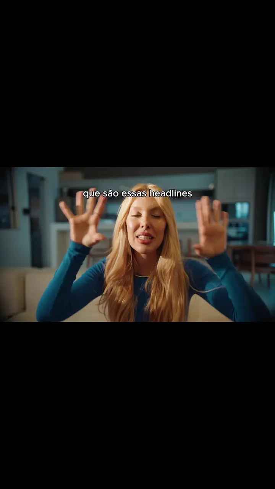 |
| 1:09–1:11 | mesmo plano, mais perto | "Não é só o gancho que importa, tá?" | palavras **rosa que se acumulam** em escada à direita do rosto ("não / é / só / o / gancho / que / importa") | 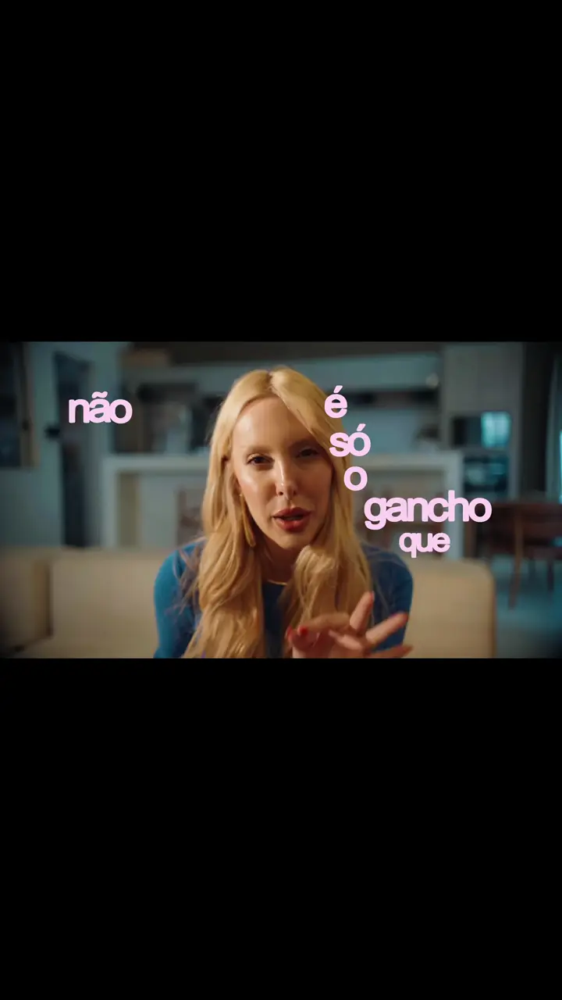 |
| 1:11–1:18 | mesmo plano; uma mão entra pela direita e entrega um cookie (1:13,5–1:14,5), ela come | "Mas como você finaliza o seu vídeo também. Como, por exemplo, comentando cookie pra receber o link na DM" | palavra única creme, posição variando (alto, centro, direita) | 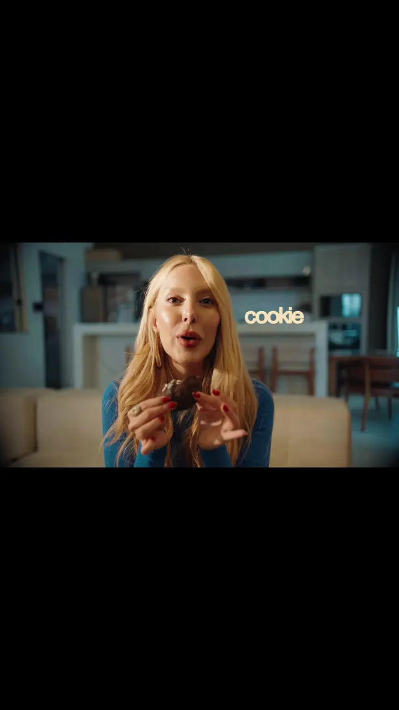 |

## Passo a passo

1. Abra com um **gancho visual antes da fala**: texto, elemento, efeito sonoro ou uma imagem atrás de
   você (`[00:12–00:24]`). O próprio abre do post é um bastidor vertical com texto nativo (`[00:00]`).
2. Ponha **movimento na primeira cena** — mexer o celular, passar maquiagem, mexer na câmera —, porque
   o olho procura movimento e ignora o estático (`[00:24–00:38]`).
3. **Dinamismo**: um ângulo diferente a cada frase (`[00:38–00:50]`).
4. **Título** que diz o assunto antes da primeira palavra: grande, colorido, com elementos, ou uma
   headline simples e agressiva (`[00:50–01:09]`).
5. Planeje o **fim** tanto quanto o gancho: feche com CTA de comentário de palavra-chave
   (`[01:09–01:18]`).
6. (inferido) Demonstre cada técnica no momento em que fala dela — o post não diz isso, mas é o que a
   edição faz do começo ao fim.

## Linguagem visual

- **Formato:** 0:00–0:03 vertical cheio (bastidor de celular, "cru"); a partir de 0:03,3 tudo em **16:9
  com faixas pretas** dentro do 9:16 (área útil 1072×608 no manifesto) até o fim — escolha de linguagem
  (bastidor amador → plano "de cinema"), não defeito de download —
   
- **Cenários:** um por capítulo — "trem" (0:03), TV com imagens trocáveis (0:12), sala/sofá com câmera na
  mão (0:24), cozinha com janelão (0:38), sofá frontal (0:50). A troca de cenário marca a troca de
  assunto. A "janela de trem" é, **presumido**, a imagem da TV do estúdio que aparece no bastidor
  `[00:00]`.
- **TV como cenário trocável:** atrás dela, a TV muda de imagem (mar, lava, penhasco, ilha) enquanto ela
  fala de "uma imagem atrás", e ela aponta a TV na palavra "atrás" —
  
- **Câmera e enquadramento:** grande-angular baixa e colada na lente nos trechos de "movimento"
  (`[00:09]`, `[00:25]`, `[00:33]`); plano aberto fixo para "estático" `[00:34–00:38]`; troca de ângulo a
  cada frase no capítulo de dinamismo `[00:38–00:50]`; plano médio frontal fixo no capítulo final.
- **Sobreposições / colagens:** prints de Reels (de outros perfis e dela) em cartões retangulares
  flutuando dos lados quando o assunto pede exemplo (`[00:13–00:18]`, `[00:19–00:22]`, `[00:25–00:32]`,
  `[00:57–01:01]`, `[01:04–01:09]`) — 
- **Ritmo de corte:** corte a cada frase ou meia frase; no capítulo 3 o corte É o conteúdo (ângulo novo
  por frase). A detecção automática achou só 2 cortes (3,27 s e 38,3 s); o ritmo saiu das folhas.
- **Cor e luz:** tratamento cinematográfico frio — azuis/verde-água nas sombras, pele quente, vinheta
  nos cantos (`[00:50]`, `[01:10]`); figurino azul petróleo combinando com a paleta.

## Legendas e texto na tela

### Sistema 1 — texto nativo do Reels (gancho)
- Onde/quando: 0:00–0:03 · centro · fonte nativa do Instagram, branca com sombra leve · 2 linhas fixas ·
  emoji ☠️ no fim · sem animação aparente.
- Por que funciona aqui: parece story de bastidor, não peça produzida; o contraste com a virada para
  16:9 é o primeiro "gancho visual".
- 

### Sistema 2 — palavra única, estilo por capítulo
- Onde/quando: 0:03–1:18 · **uma palavra por vez** (quase sempre) · sem serifa, bold, sem fundo · a
  posição e a cor mudam com o capítulo.
- Trem (0:03–0:09): **azul**, média, dentro da paisagem da janela — 
- Close de movimento (0:09–0:12) e capítulo 1 (0:12–0:24): creme, canto inferior direito ou alto; uma
  palavra em rosa ("que") — 
- Capítulo "estático" (0:34–0:38): creme **grande** acima da cabeça — 
- Capítulo dinamismo (0:38–0:50): **rosa** nas palavras-chave, creme no resto — 
- Capítulo títulos (0:50–0:55): pequena, à esquerda do rosto — 
- Fecho (1:11–1:18): creme, posição saltando entre alto, centro e direita — 
- Por que funciona aqui: a palavra única puxa o olho a cada palavra forte sem competir com o rosto; a
  cor por capítulo sinaliza a troca de assunto junto com o cenário.

### Sistema 3 — metalinguagem (a legenda vira o que a fala descreve)
- "títulos que ocupam a tela inteira" `[00:55,5–00:57]`: as palavras crescem até ocupar a base do quadro,
  creme, gigantes — 
- "headlines simples" `[01:03,5–01:04,5]`: a legenda vira **texto nativo pequeno branco no alto**, como uma
  headline de Reels — 
- "não é só o gancho que importa" `[01:09,5–01:11]`: palavras **rosa empilhadas em escada**, acumulando em
  vez de trocar — 
- Na mesma lógica, fora da legenda: TV muda quando ela diz "imagem atrás" `[00:24]`; câmera treme no
  "movimento" `[00:25–00:33]`; plano parado no "estático" `[00:34–00:38]`; ângulo troca a cada frase no
  "dinamismo" `[00:38–00:50]`; o CTA "comentando cookie" vem com um cookie entregue na mão `[01:13–01:16]`.

## Ferramentas

- Nenhuma ferramenta de edição é nomeada no post.
- Visíveis no bastidor `[00:00]`: duas câmeras em tripé, uma luz com difusor/refletor, TV de fundo
  usada como cenário. Modelo de câmera: não verificável.
- App de edição: não verificável — nada na tela indica.

## Citações com tempo

- `[00:00]` (tela) "nem a p4u que isso vai funcionar ☠️"
- `[00:04]` "Você tem três segundos para aprender a atenção das pessoas e tudo começa com um gancho."
- `[00:09]` "E existem quatro padrões que se repetem em todo o vídeo viral."
- `[00:25]` "O segundo é o movimento logo na primeira cena."
- `[00:34]` "O nosso olhar presta atenção no movimento e não em algo estático parado."
- `[00:39]` "Para cada frase que você falar, você grava em um ângulo diferente."
- `[00:55]` "Esses títulos que ocupam a tela inteira…"
- `[01:09]` "Não é só o gancho que importa, tá?"
- `[01:15]` "…comentando cookie pra receber o link na DM."

Correções da transcrição (whisperx small), todas pelo portão da tela: "Osso olhar" → **"nosso"**
(tela `[00:34,5]`); "dopaminético" → **"dopaminérgico"** (tela `[00:46]`); "Kuki" → **"cookie"** (tela
`[01:16]`); "aprender" mantido porque está escrito assim na tela `[00:06]`. "temporal" `[01:03]` mantido: está
escrito na tela (palavra única creme, centro) — conferido depois em revisão, com zoom a 4 qps.

## Como reproduzir

- **Estrutura:** um capítulo por ideia, e **cada ideia demonstrada pela própria edição no instante em
  que é dita** (metalinguagem). É a técnica a copiar, não o roteiro "4 padrões".
- **Gravação:** abre de 3 s em vertical cheio, celular na mão, bastidor real; o resto gravado com sobra
  lateral para virar 16:9. Um cenário por capítulo; no trecho que fala de variedade/dinamismo, pelo
  menos 3 ângulos da mesma fala (aberto, close na lente, médio).
- **Edição (Remotion):** letterbox 16:9 dentro do 1080×1920 a partir do corte de virada; legenda palavra
  a palavra a partir da transcrição alinhada (`scripts/alinhar_forcado.py`, lição 56), com **paleta por
  capítulo** declarada no briefing; um "modo gigante" (palavra ocupando a base) e um "modo nativo"
  (texto pequeno branco no alto) só nos trechos em que a fala trata disso; palavras acumulando em escada
  para a frase-tese do fecho. Cartões de exemplo flutuantes = material nosso, nunca print de terceiro.
- **O que precisa existir antes:** roteiro escrito com a coluna "o que a tela faz" por frase (a
  demonstração é planejada, não achada na edição); material próprio para os cartões de exemplo.

## Onde se aplica na Canastra

- **Reel educativo de café** (linha das "Onze provas", 08b): explicar uma etapa e fazer a tela
  demonstrá-la no mesmo quadro — ao dizer "secagem lenta", o plano fica parado e longo; ao dizer
  "catação", corte rápido grão a grão; ao dizer "nota 80+", o número ocupa a tela inteira. É a
  metalinguagem deste post aplicada a assunto de café.
- **Abertura bastidor vertical → 16:9:** 3 s de celular cru na fazenda ou na torrefação (vídeo próprio;
  luz real de sol a pino) e depois o plano "cinema". Cabe no motor de `instagram/remotion` como cena de
  abertura + máscara de letterbox.
- **Legenda por capítulo:** compatível com o padrão aprovado do 08b v3 (sem pílula, só a palavra-chave
  no quadro em que a voz a diz — lição 68); este post acrescenta **cor por capítulo** e os dois modos
  especiais (gigante e nativo) como recurso pontual.
- **CTA de palavra-chave com objeto na mão:** na Canastra, xícara ou pacote real em mão de pessoa real
  (vídeo gravado, nunca rosto sintetizado).

## Cuidados com as regras da marca

- O CTA do post usa **cookie** — objeto de fora do café. Pela lição 66, palavra-chave e objeto do CTA da
  Canastra vêm de dentro do café (grão, xícara, coado…), nunca comida ou objeto alheio.
- Ao copiar o fundo de TV trocável: nada de imagem de **fogo/lava** atrás de assunto de torra (o post
  usa lava em `[00:14–00:18]`); torra nunca com fogo, fumaça ou grão preto.
- Os cartões de exemplo do post são Reels de terceiros: na Canastra, cartões só com material próprio;
  conteúdo de terceiro nunca vira pixel nem referência de geração.
- Rosto de pessoa real nunca é sintetizado: a técnica pede gravação de verdade, não avatar.
- Não copiar o bordão de abertura ("nem a p4u…") nem o enquadramento-assinatura da criadora.

## Arquivos locais

- Mídia (fora do repositório): `C:\Users\rafae\AppData\Local\Temp\conteudo-DdCgqeEAAIw\v.mp4` (1080×1920,
  77,8 s); `...\watch-yekkoc8p\` (download do yt-dlp, `video.info.json`, áudio, quadros do watch);
  `...\folhas\` (13 folhas + `manifesto.json`); `...\zoom\` (18 quadros ampliados).
- Prints salvos em `quadros/rafaelachagas_DdCgqeEAAIw/` (20): `01_00-00`, `02_00-03`, `03_00-05`,
  `04_00-09`, `05_00-13`, `06_00-15`, `07_00-19`, `08_00-24`, `09_00-25`, `10_00-30`, `11_00-34`,
  `12_00-37`, `13_00-40`, `14_00-41`, `15_00-47`, `16_00-50`, `17_00-56`, `18_01-03`, `19_01-10`,
  `20_01-16` (todos `.webp`).
